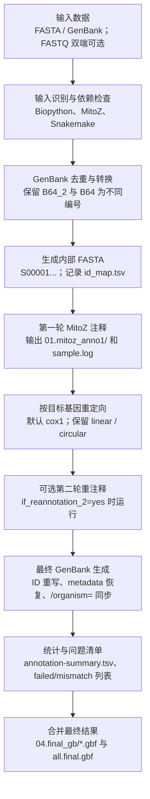
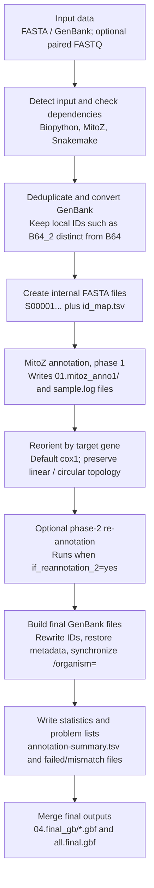

# batch_mitoz.py 使用说明 / User Guide

本文档说明 `batch_mitoz.py` 的用途、输入格式、各子命令、常用参数、输出文件和工作流程。
This document explains the purpose, inputs, subcommands, key options, outputs, and workflow of `batch_mitoz.py`.

## MitoM：声明、致谢与引用 / Statement, acknowledgements and citation

**MitoM**（命令名 `mitom`；M = Merge / Metazoa）把多个优秀软件的长处整合成一条动物线粒体基因组注释流程：MitoZ 定位蛋白基因，MITOS2 注释 tRNA，MFannot 方法加内含子，并做端点校正和 NCBI 校验；每个环节选哪个软件，都以 benchmark 结果为依据（`benchmark/`）。

**MitoM** (command name `mitom`; M = Merge / Metazoa) combines the strengths of several excellent tools into one annotation workflow for animal mitochondrial genomes: MitoZ for protein-coding genes, MITOS2 for tRNAs, the MFannot method for introns, plus boundary curation and NCBI validation. Which tool handles each step is decided by benchmark results (`benchmark/`).

**声明 / Statement**

- 本软件基于作者多年研究中的一些心得，整合了大家的优秀软件，并使用 Claude Code（Anthropic）开发。
- 作者不保留任何版权：本仓库代码以 CC0 1.0 放入公有领域（见 `LICENSE`），任何人都可以使用、修改、再发布，欢迎持续优化升级。
- 使用本软件时，请引用本 GitHub 仓库，其他没有任何要求。
- This software builds on the author's experience from years of research. It integrates excellent tools written by others and was developed with Claude Code (Anthropic).
- The author claims no copyright: the code in this repository is dedicated to the public domain under CC0 1.0 (see `LICENSE`). Anyone may use, modify and redistribute it, and further improvements are welcome.
- If you use it, please cite this GitHub repository. Nothing else is required.

**第三方软件 / Third-party tools**

本软件调用的软件不随本仓库分发，需要单独安装（`install.sh`），并各自保留原有许可证：例如 MitoZ 为 GPL-3.0，MITOS2 为 MIT（据 bioconda 包信息）。

The tools that MitoM runs are not distributed with this repository and are installed separately (`install.sh`). Each keeps its own license, e.g. MitoZ GPL-3.0 and MITOS2 MIT (per their bioconda packages).

**致谢 / Acknowledgements**

感谢 MitoZ、MITOS2/MITOS、MiTFi、MFannot、Infernal、BLAST+、GeneWise、Exonerate、NCBI table2asn、Biopython 等软件的作者。没有他们的工作，就没有本软件。

We thank the authors of MitoZ, MITOS2/MITOS, MiTFi, MFannot, Infernal, BLAST+, GeneWise, Exonerate, NCBI table2asn, Biopython and the other tools listed below. This software would not exist without their work.

**引用 / Citation**

引用本软件的同时，请一并引用实际用到的软件 / When citing this software, please also cite the tools it ran:

- 本软件 / This software: https://github.com/deyuanyang92-dev/Temp_scripts (`CITATION.cff`)
- MitoZ: Meng G, et al. 2019. Nucleic Acids Res. doi:10.1093/nar/gkz173
- MITOS2: Donath A, et al. 2019. Nucleic Acids Res. doi:10.1093/nar/gkz833
- MITOS: Bernt M, et al. 2013. Mol Phylogenet Evol. doi:10.1016/j.ympev.2012.08.023
- MiTFi (tRNA models used by MITOS2 and MitoZ): Jühling F, et al. 2012. Nucleic Acids Res. doi:10.1093/nar/gkr1131
- Infernal: Nawrocki EP, Eddy SR. 2013. Bioinformatics. doi:10.1093/bioinformatics/btt509
- BLAST+: Camacho C, et al. 2009. BMC Bioinformatics. doi:10.1186/1471-2105-10-421
- GeneWise (used by MitoZ): Birney E, et al. 2004. Genome Res. doi:10.1101/gr.1865504
- 内含子 / introns（`mito_intron.py`）— MFannot: Lang BF, et al. 2023. Front Plant Sci. doi:10.3389/fpls.2023.1222186; Exonerate: Slater GSC, Birney E. 2005. BMC Bioinformatics. doi:10.1186/1471-2105-6-31
- 端点校正依据 / boundary curation rules（`mito_curate.py`）: Fourdrilis S, et al. 2018. Sci Rep 8:17964. doi:10.1038/s41598-018-36428-7; Ghiselli F, et al. 2021. Phil Trans R Soc B. doi:10.1098/rstb.2020.0159
- 可选 tRNA 工具 / optional tRNA tools（`mito_trna.py`）: ARWEN doi:10.1093/bioinformatics/btm573; ARAGORN doi:10.1093/nar/gkh152; tRNAscan-SE 2.0 doi:10.1093/nar/gkab688
- Biopython: Cock PJA, et al. 2009. Bioinformatics. doi:10.1093/bioinformatics/btp163
- NCBI table2asn: https://www.ncbi.nlm.nih.gov/genbank/table2asn/

## 脚本定位 / What The Script Does

`batch_mitoz.py` 是一个 MitoZ 批量线粒体注释和 GenBank 后处理管线。

`batch_mitoz.py` is a batch MitoZ annotation and GenBank post-processing pipeline for mitochondrial sequences.

它主要完成：

- 识别 FASTA 或 GenBank 输入。
- 把 GenBank 输入去重并转换为内部 FASTA。
- 为每条记录生成短内部 ID，例如 `S00001`，避免 MitoZ 或 GenBank LOCUS 名称过长。
- 批量调用 MitoZ 注释。
- 按目标基因重定向序列，默认 `cox1`。
- 可选对重定向后的序列做第二轮 MitoZ 注释。
- 把原始 GenBank header metadata 转移回最终结果。
- 修复 MitoZ 输出中 `FEATURES source` 的 `/organism=`。
- 输出最终 `.gbf`、统计表、日志、失败列表和合并文件。

It can:

- Detect FASTA or GenBank input.
- Deduplicate GenBank records and convert them to internal FASTA.
- Generate short internal IDs such as `S00001`.
- Run MitoZ annotation in batch.
- Reorient records by a target gene, defaulting to `cox1`.
- Optionally run a second MitoZ annotation pass after reorientation.
- Restore original GenBank header metadata.
- Restore `/organism=` inside `FEATURES source`.
- Write final `.gbf` files, summary tables, logs, failure lists, and merged GenBank archives.

## 依赖 / Requirements

基础依赖：

- Python 3.8+
- Biopython
- MitoZ，真实运行 `annotate` 或 `run` 必需
- Snakemake，可选，用于调度多任务
- Conda，可选，用于 `--conda_env_mitoz`

Basic requirements:

- Python 3.8+
- Biopython
- MitoZ, required for real `annotate` or `run` jobs
- Snakemake, optional scheduler
- Conda, optional when using `--conda_env_mitoz`

检查帮助：

```bash
python3 batch_mitoz.py --help
python3 batch_mitoz.py run --help
python3 batch_mitoz.py annotate --help
python3 batch_mitoz.py reorient --help
python3 batch_mitoz.py transfer_metadata --help
python3 batch_mitoz.py replace_organism --help
```

## 输入格式 / Input Formats

### FASTA 输入 / FASTA Input

支持扩展名：

```text
.fa .fasta .fna .fas
```

FASTA header 中可以包含 topology：

```text
>B9  topology=linear
ATGC...
```

如果没有写 `topology=linear` 或 `topology=circular`，脚本默认按 `circular` 处理。

Supported FASTA extensions are `.fa`, `.fasta`, `.fna`, and `.fas`. If no topology tag is present, the script assumes `circular`.

### GenBank 输入 / GenBank Input

支持扩展名：

```text
.gb .gbk .genbank .gbf
```

GenBank 输入会先执行：

1. 解析所有 record。
2. 跳过无序列 record，但保留其 metadata 来源索引。
3. 去除完全重复、版本重复或序列重复的 record。
4. 转换为内部 FASTA 后再进入 MitoZ。

GenBank input is parsed, deduplicated, converted to internal FASTA, and then passed to MitoZ.

注意：当前版本已避免把本地样本名 `B64_2` 误认为 accession version，因此 `B64` 和 `B64_2` 会保持为不同样本。

Note: local IDs such as `B64_2` are kept distinct from `B64`.

### 目录扫描与多序列 FASTA / Directory Scanning And Multi-record FASTA

输入目录会递归扫描。若同一目录同时包含 FASTA 和 GenBank，`annotate` / `run` 会优先使用 GenBank 文件，并忽略该目录中的 FASTA 文件。

Input directories are scanned recursively. If a directory contains both FASTA and GenBank files, `annotate` / `run` use the GenBank files and ignore the FASTA files in that mixed directory.

多记录 FASTA 默认会按 record 拆分：

```bash
--if_split_fasta yes
```

如果设置：

```bash
--if_split_fasta no
```

但输入 FASTA 含多个 record，脚本会报错退出。

By default, multi-record FASTA files are split into individual records. With `--if_split_fasta no`, a multi-record FASTA causes the script to exit with an error.

### FASTQ 输入 / Optional FASTQ Input

FASTQ 仅用于 `annotate` / `run`，并且只在同时找到 `fq1` 和 `fq2` 时传给 MitoZ。脚本按最终 `sample_name` 查找双端 FASTQ。

FASTQ options are only used by `annotate` / `run`. Files are passed to MitoZ only when both `fq1` and `fq2` are found. Matching is based on the final `sample_name`.

如果 MitoZ 需要 paired FASTQ，可使用：

```bash
--infq /path/to/fastq_dir
--fq_position flat
--suffix_fq _1.clean.fq.gz,_2.clean.fq.gz
```

`--fq_position flat` 表示 FASTQ 文件直接在 `--infq` 目录下：

```text
<sample_name>_1.clean.fq.gz
<sample_name>_2.clean.fq.gz
```

`--fq_position sample_dir` 表示每个样本有单独子目录：

```text
fastq_dir/<sample_name>/<sample_name>_1.clean.fq.gz
fastq_dir/<sample_name>/<sample_name>_2.clean.fq.gz
```

在 `sample_dir` 模式下，脚本会优先找精确文件名；如果没有精确文件名，会取该样本子目录中第一个匹配 `*suffix1` 和 `*suffix2` 的文件。`--suffix_fq` 必须是两个逗号分隔的后缀。

In `sample_dir` mode, exact filenames are preferred. If exact names are absent, the first files matching `*suffix1` and `*suffix2` in the sample subdirectory are used. `--suffix_fq` must contain exactly two comma-separated suffixes.

## 子命令总览 / Subcommands

| 子命令 | 用途 | English |
|---|---|---|
| `run` | 完整流程：注释、重定向、可选二轮注释、最终 GenBank 生成 | Full pipeline |
| `annotate` | 只做批量 MitoZ 注释和最终整理 | Annotation only |
| `reorient` | 只对已有 GenBank 按目标基因重定向 | Reorient existing GenBank |
| `transfer_metadata` | 单独转移 GenBank header metadata | Standalone metadata transfer |
| `replace_organism` | 单独修复 `/organism=` 和 SOURCE | Standalone organism/source restoration |

## 推荐主流程：run / Recommended Main Workflow

`run` 是最完整、最推荐的子命令。

`run` is the recommended full pipeline.

典型流程：

```text
输入 FASTA / GenBank
→ 内部 FASTA 和 id_map.tsv
→ 第一轮 MitoZ 注释
→ 按 cox1 或指定基因重定向
→ 可选第二轮 MitoZ 注释
→ 最终 ID 重写
→ metadata 恢复
→ /organism= 同步
→ 统计和合并输出
```

### 用 Conda 环境运行 / Run With A Conda MitoZ Environment

```bash
python3 batch_mitoz.py run \
  -i /path/to/input_fasta_or_genbank \
  -o mitoz_run_out \
  --conda_env_mitoz mitoz3.6 \
  --scheduler_backend threads \
  --threads 8 \
  --max_tasks 4 \
  --clade Arthropoda \
  --genetic_code 5 \
  --which_gene_first cox1 \
  --if_reannotation_2 yes \
  --preserve_phase1_metadata yes
```

### 用指定 MitoZ 路径运行 / Run With A MitoZ Executable Path

```bash
python3 batch_mitoz.py run \
  -i /path/to/input_fasta_or_genbank \
  -o mitoz_run_out \
  --mitoz_path /path/to/mitoz \
  --scheduler_backend threads \
  --threads 8 \
  --max_tasks 4 \
  --clade Arthropoda \
  --genetic_code 5
```

`--mitoz_path` 可以是 MitoZ 可执行文件，也可以是包含 `mitoz` 的目录。

`--mitoz_path` can point to the MitoZ executable or to a directory containing it.

### 当前目录 FASTA 示例 / Example For The Current Directory

当前目录已有：

```text
summary_all.fasta
rename_summary_all.fasta
```

如果要用已改名后的 FASTA 跑完整流程，可用：

```bash
python3 batch_mitoz.py run \
  -i rename_summary_all.fasta \
  -o mitoz_run_renamed_out \
  --conda_env_mitoz mitoz3.6 \
  --scheduler_backend threads \
  --threads 8 \
  --max_tasks 4 \
  --clade Arthropoda \
  --genetic_code 5 \
  --which_gene_first cox1
```

请把 `mitoz3.6`、`Arthropoda`、`genetic_code` 改成你真实数据需要的值。

Replace `mitoz3.6`, `Arthropoda`, and `genetic_code` with values appropriate for your dataset.

### 带 FASTQ 的 run 示例 / run With Optional FASTQ

```bash
python3 batch_mitoz.py run \
  -i input.fasta \
  -o mitoz_run_out \
  --conda_env_mitoz mitoz3.6 \
  --infq /path/to/fastq_dir \
  --fq_position sample_dir \
  --suffix_fq _1.clean.fq.gz,_2.clean.fq.gz \
  --scheduler_backend threads \
  --threads 8 \
  --max_tasks 4 \
  --clade Arthropoda \
  --genetic_code 5
```

### Snakemake 调度示例 / Snakemake Scheduler Example

```bash
python3 batch_mitoz.py run \
  -i input.fasta \
  -o mitoz_run_out \
  --conda_env_mitoz mitoz3.6 \
  --scheduler_backend snakemake \
  --snakemake_bin /path/to/snakemake \
  --smk_cores 64 \
  --smk_mem_mb 256000 \
  --smk_latency_wait 60 \
  --smk_extra '--profile slurm' \
  --threads 8 \
  --max_tasks 8 \
  --clade Arthropoda \
  --genetic_code 5
```

## 一轮注释：annotate / Annotation Only

`annotate` 只运行第一轮 MitoZ 注释，并把 MitoZ 结果整理为最终 `.gbf`。

`annotate` runs one MitoZ annotation pass and finalizes the `.gbf` output.

注意：`annotate` 不做第二轮注释，但最终 `.gbf` 写出前仍会执行 ID 重写，并按 `--which_gene_first` 做一次保证性重定向；默认目标基因为 `cox1`，负链目标基因默认会反向互补。`--preserve_phase1_metadata` 在 `annotate` 中默认是 `no`，只有 GenBank 输入且显式设为 `yes` 时才恢复原始 header metadata。

Note: `annotate` does not run phase-2 annotation, but final `.gbf` files are still ID-rewritten and reoriented by `--which_gene_first`. Metadata preservation defaults to `no` for `annotate`.

```bash
python3 batch_mitoz.py annotate \
  -i /path/to/fasta_or_genbank \
  -o annotate_out \
  --conda_env_mitoz mitoz3.6 \
  --scheduler_backend threads \
  --threads 8 \
  --max_tasks 4 \
  --clade Arthropoda \
  --genetic_code 5
```

适合：

- 不需要第二轮注释。
- 只想批量运行 MitoZ 并标准化输出文件名。

Use it when one annotation pass is enough.

追加 MitoZ 参数示例：

```bash
python3 batch_mitoz.py annotate \
  -i input.fasta \
  -o annotate_out \
  --conda_env_mitoz mitoz3.6 \
  --mitoz_extra '--your-extra-mitoz-flag value'
```

## 只重定向：reorient / Reorient Only

`reorient` 不运行 MitoZ，只处理已有 GenBank 文件。

`reorient` does not run MitoZ. It only reorients existing GenBank files.

`reorient` 的 `-i` 必须是 GenBank 文件或 GenBank 目录；FASTA 输入不会被该 workflow 处理。由于该子命令复用了通用参数，帮助中会显示 `--if_split_fasta` 和 `--id_maxlen`，但它们对 `reorient` 无实际作用。

For `reorient`, `-i` must be a GenBank file or directory. FASTA input is not processed by this workflow. `--if_split_fasta` and `--id_maxlen` appear in the shared help output but have no practical effect for `reorient`.

```bash
python3 batch_mitoz.py reorient \
  -i /path/to/genbank_dir \
  -o reorient_out \
  --which_gene_first cox1
```

如果目标基因在负链上，默认会反向互补，使目标基因转到正向。如果不想这样做：

```bash
python3 batch_mitoz.py reorient \
  -i /path/to/genbank_dir \
  -o reorient_out \
  --which_gene_first cox1 \
  --no_force_forward
```

By default, minus-strand target genes are reverse-complemented. Use `--no_force_forward` to disable that behavior.

## 单独转移 metadata / Standalone Metadata Transfer

`transfer_metadata` 用原始 GenBank 的 header 区域替换重新注释 GenBank 的 header 区域，保留新文件的 `FEATURES` 和 `ORIGIN` 主体。

`transfer_metadata` replaces the header section of re-annotated GenBank files with metadata from the original GenBank files while keeping the new `FEATURES` and `ORIGIN`.

```bash
python3 batch_mitoz.py transfer_metadata \
  -m /path/to/original_gb_dir \
  -n /path/to/new_body_gb_dir \
  -o transfer_metadata_out \
  --smart_metadata no
```

单文件模式可指定输出文件名：

```bash
python3 batch_mitoz.py transfer_metadata \
  -m original.gbf \
  -n reannotated.gbf \
  -o transfer_metadata_out \
  --output_name final_with_metadata.gbf
```

如果需要自动接受模糊匹配：

```bash
python3 batch_mitoz.py transfer_metadata \
  -m original.gbf \
  -n reannotated.gbf \
  -o transfer_metadata_out \
  --smart_metadata yes \
  --auto_accept_metadata yes
```

注意：目录模式下如果 metadata 目录中存在多个相同 stem 的文件，脚本会报错退出，避免错配 header。

In directory mode, duplicate metadata stems are rejected to avoid header mismatches.

输出与行为：

- 输出目录默认是 `transfer_metadata_out/`。
- 新文件默认写入 `transfer_metadata_out/transferred_gb/`。
- 审计表是 `transfer_metadata.tsv`。
- 日志是 `transfer_metadata.log`。
- 目录模式按文件 stem 配对 `metadata` 与 `new_body`；metadata 目录中重复 stem 会报错退出。
- `--output_name` 仅单文件模式有效。
- `--overwrite_new_body yes` 会直接覆盖 `-n/--new_body` 指定的 body 文件。
- `--if_replace_metadata no` 时不替换 header，只复制或保留 new body。

Outputs and behavior:

- Default output root: `transfer_metadata_out/`.
- New files are written to `transfer_metadata_out/transferred_gb/` by default.
- Audit table: `transfer_metadata.tsv`.
- Log file: `transfer_metadata.log`.
- Directory mode pairs metadata and body files by stem; duplicate metadata stems are rejected.
- `--output_name` is valid only in single-file mode.
- `--overwrite_new_body yes` overwrites the files supplied by `-n/--new_body`.
- `--if_replace_metadata no` keeps or copies the new body without replacing the header.

## 单独修复 organism / Standalone Organism Replacement

`replace_organism` 修复 `FEATURES source` 中的 `/organism=`，也可以同步 SOURCE 文本。

`replace_organism` restores `/organism=` inside `FEATURES source` and can also sync the SOURCE text.

```bash
python3 batch_mitoz.py replace_organism \
  -m /path/to/original_gb_dir \
  -n /path/to/new_body_gb_dir \
  -o replace_organism_out
```

如需覆盖输入文件：

```bash
python3 batch_mitoz.py replace_organism \
  -m /path/to/original_gb_dir \
  -n /path/to/new_body_gb_dir \
  --overwrite_new_body yes
```

Use overwrite mode carefully because it modifies the input body files in place.

输出与匹配规则：

- 输出目录默认是 `replace_organism_out/`。
- 新文件默认写入 `replace_organism_out/replaced_organism/`。
- 审计表是 `replace_organism.tsv`，列为 `source_file`, `output_file`, `replaced`, `not_found`, `total`, `note`。
- 日志是 `replace_organism.log`。
- 匹配依据是 GenBank accession 及其兼容变体。
- 匹配成功时更新 SOURCE 文本和 source feature 的 `/organism=`。
- 未匹配 record 保持不变。

Outputs and matching:

- Default output root: `replace_organism_out/`.
- New files are written to `replace_organism_out/replaced_organism/` by default.
- Audit table: `replace_organism.tsv`.
- Log file: `replace_organism.log`.
- Matching uses GenBank accessions and compatible accession variants.
- On match, SOURCE text and source-feature `/organism=` are updated.
- Unmatched records are left unchanged.

## 关键参数 / Key Options

| 参数 | 适用子命令 | 中文说明 | English |
|---|---|---|---|
| `-i`, `--input` | `run`, `annotate`, `reorient` | FASTA 或 GenBank 文件/目录；`reorient` 只处理 GenBank | Input FASTA or GenBank; `reorient` accepts GenBank only |
| `-o`, `--out_root` | all | 输出根目录；`run`/`annotate`/`reorient` 默认 `mitoz_batch_out`，其他子命令各有默认值 | Output root; defaults vary by subcommand |
| `--which_gene_first` | `run`, `annotate`, `reorient` | 重定向起始基因，默认 `cox1` | Target gene for reorientation, default `cox1` |
| `--fallback_genes` | `run`, `annotate` | 找不到 `--which_gene_first`（默认 cox1）时依次尝试的基因，默认 `cox2,cox3,cob,nad1`；`none` = 不旋转（旧行为）。用了备选基因的样本列在 `oriented_by_fallback.txt`。基因被注释成多段（如 intron 两侧外显子）时取转录方向最 5′ 的一段；线性序列从不旋转 | Fallback start genes when the first gene is absent; 5'-most piece of split genes; linear records never rotated |
| `--force_forward` / `--no_force_forward` | `run`, `annotate`, `reorient` | 目标基因在负链时是否反向互补，默认开启 | Reverse-complement minus-strand target genes by default |
| `--if_split_fasta` | `run`, `annotate` | 多序列 FASTA 是否拆分，默认 `yes`；对 `reorient` 无实际作用 | Split multi-record FASTA, default `yes`; no practical effect for `reorient` |
| `--id_maxlen` | `run`, `annotate` | 内部 ID 最大长度，必须至少 6；对 `reorient` 无实际作用 | Maximum internal ID length, minimum 6; no practical effect for `reorient` |
| `--conda_exe` | `run`, `annotate` | Conda 可执行文件名，默认 `conda` | Conda executable, default `conda` |
| `--conda_env_mitoz` | `run`, `annotate` | 含 MitoZ 的 Conda 环境名 | Conda environment containing MitoZ |
| `--mitoz_path` | `run`, `annotate` | MitoZ 可执行文件或目录 | Path to MitoZ executable or directory |
| `--threads` | `run`, `annotate` | 每个 MitoZ 任务线程数，必须为正整数 | Threads per MitoZ job, positive integer |
| `--max_tasks` | `run`, `annotate` | 同时运行的任务数，必须为正整数 | Maximum concurrent jobs, positive integer |
| `--clade` | `run`, `annotate` | MitoZ clade，必须按物种设置 | MitoZ clade, set for your taxa |
| `--genetic_code` | `run`, `annotate` | 遗传密码表，默认 5 | Genetic code, default 5 |
| `--species_name` | `run`, `annotate` | 传给 MitoZ annotate 的物种名 | Species name passed to MitoZ annotate |
| `--mitoz_extra ARG` | `run`, `annotate` | 追加传给 MitoZ annotate 的参数，可重复 | Extra MitoZ annotate arguments, repeatable |
| `--infq`, `--fq_position`, `--suffix_fq` | `run`, `annotate` | 可选双端 FASTQ；`--suffix_fq` 必须有两个逗号分隔后缀 | Optional paired FASTQ; suffix list must contain two comma-separated values |
| `--scheduler_backend` | `run`, `annotate` | `auto` / `threads` / `snakemake`，默认 `auto` | Scheduler backend, default `auto` |
| `--snakemake_bin`, `--smk_cores`, `--smk_mem_mb`, `--smk_latency_wait`, `--smk_extra` | `run`, `annotate` | Snakemake 后端参数；数值项必须为正整数 | Snakemake backend options; numeric values must be positive integers |
| `--if_reannotation_2` | `run` | 是否运行第二轮注释，默认 `yes` | Enable phase-2 re-annotation, default `yes` |
| `--keep_intermediate` | `run`, `annotate` | 是否保留内部 ID 中间文件（`00.*`、`01.*`、`03.*`、`04.final_body_merged`、`id_map.tsv`），默认 `no`：最终输出写完后删除以节约空间；`dedup_report.tsv` 移到输出根目录，问题样本的 MitoZ 日志复制到 `failed_logs/` | Keep internal-ID intermediates; default `no` deletes them after final output (dedup report moved to root, problem-sample logs kept in `failed_logs/`) |
| `--preserve_phase1_metadata` | `run`, `annotate` | `run` 默认 `yes`；`annotate` 默认 `no` | Defaults to `yes` for `run`, `no` for `annotate` |
| `--smart_metadata` | `run`, `transfer_metadata` | 开启模糊 metadata 匹配 | Enable fuzzy metadata matching |
| `--auto_accept_metadata` | `run`, `transfer_metadata` | 自动接受最佳模糊匹配；必须配合 `--smart_metadata yes` | Auto-accept best fuzzy match; requires `--smart_metadata yes` |
| `-m`, `--metadata` | `transfer_metadata`, `replace_organism` | 原始 GenBank metadata 来源 | Original GenBank metadata source |
| `-n`, `--new_body` | `transfer_metadata`, `replace_organism` | 新 GenBank body 来源 | New GenBank body source |
| `--if_replace_metadata` | `transfer_metadata` | 是否替换 header metadata，默认 `yes` | Replace header metadata, default `yes` |
| `--overwrite_new_body` | `transfer_metadata`, `replace_organism` | 是否原地覆盖 `new_body` | Overwrite `new_body` in place |
| `--output_name` | `transfer_metadata` | 单文件模式输出文件名 | Output filename in single-file mode |

## 调度建议 / Scheduler Recommendations

### threads 后端 / threads Backend

本地机器推荐先用：

```bash
--scheduler_backend threads --threads 8 --max_tasks 4
```

实际总线程消耗约为：

```text
threads × max_tasks
```

例如 `8 × 4 = 32`。请不要超过机器可承受的 CPU 和内存。

The approximate CPU demand is `threads × max_tasks`.

### Snakemake 后端 / Snakemake Backend

```bash
--scheduler_backend snakemake \
--smk_cores 64 \
--smk_mem_mb 256000 \
--threads 8 \
--max_tasks 8
```

当前版本生成的 Snakefile 会把每个任务声明为真实 `threads`，并声明每任务内存资源，避免调度器误判。

The generated Snakefile declares real per-job `threads` and memory resources.

## 输出目录 / Output Layout

完整 `run` 输出通常包括：

```text
mitoz_run_out/
├── pipeline.log
├── run_params.json
├── 00.internal_fasta/
│   ├── S00001.fasta
│   └── id_map.tsv
├── 00.gb_converted_fasta/
│   └── dedup_report.tsv
├── 00.reoriented_fasta_internal/
├── 01.mitoz_anno1/
├── 03.mitoz_anno2_reoriented/
├── 04.final_gb/
│   ├── SAMPLE.gbf
│   └── no_{which_gene_first}_gene/
├── annotation-summary.tsv
├── metadata_transfer_log.tsv
├── all.final.gbf
├── annotation_failed.txt
├── final_write_failed.txt
├── reorient_failed.txt
├── metadata_transfer_failed.txt
├── metadata_key_mismatch.txt
└── all_problem_samples.txt
```

主要文件：

- `pipeline.log`: 总日志。
- `sample.log`: 每个样本的 MitoZ 运行日志。
- `id_map.tsv`: 内部 ID 与原始样本名映射。
- `dedup_report.tsv`: GenBank 输入去重报告。
- `annotation-summary.tsv`: 最终 PCG / tRNA / rRNA 统计。
- `metadata_transfer_log.tsv`: metadata 转移审计。
- `04.final_gb/*.gbf`: 最终 GenBank 文件。
- `all.final.gbf`: 合并后的最终 GenBank。
- `*_failed.txt`, `*_mismatch.txt`: 问题样本列表。

`annotation-summary.tsv` 中的 `cox1_orientation_ok` 是历史列名。当 `--which_gene_first` 不是 `cox1` 时，该列实际表示指定目标基因是否重定向成功。

The `cox1_orientation_ok` column name is historical. If `--which_gene_first` is not `cox1`, the column still means whether the selected target gene was successfully used for reorientation.

`annotate` 输出通常包括：

```text
annotate_out/
├── pipeline.log
├── run_params.json
├── 00.internal_fasta/
│   └── id_map.tsv
├── 00.gb_converted_fasta/
│   └── dedup_report.tsv
├── 01.mitoz_anno1/
├── 04.final_gb/
├── annotation-summary.tsv
├── all.final.gbf
├── annotation_failed.txt
└── final_write_failed.txt
```

默认（`--keep_intermediate no`）跑完后上面的 `00.*`、`01.*`、`03.*` 目录会被删除，只留 `04.final_gb/`、`all.final.gbf`、各统计表、`pipeline.log`、`run_params.json`、`dedup_report.tsv` 和 `failed_logs/`（仅有问题样本时）。

By default (`--keep_intermediate no`) the `00.*`, `01.*` and `03.*` directories are deleted after the run.

列表和 TSV 在内容为空时可能不会生成。

Some report files are written only when non-empty.

## 注释后校正 / Post-annotation curation (mito_curate.py)

对注释好的 GenBank（MitoZ、MITOS 等输出）单独运行，按 Fourdrilis et al. 2018 的软体动物（腹足类）注释准则修正 PCG 与 12S/16S，准则引自 Ghiselli et al. 2021, *Phil. Trans. R. Soc. B* 376:20200159（doi:10.1098/rstb.2020.0159，第 3 节）：

| 规则 | 准则 | 做法 |
|---|---|---|
| P1 | (i) 起始密码子取离上游基因最近且不重叠者 | 起点与上游 tRNA/rRNA 或同框 PCG 重叠 → 后移到第一个起始密码子；首密码子非起始密码子时才向上游找（`--aggressive_start` 总是按准则找最上游） |
| P2 | (ii) 同链同框 PCG 不可重叠（不同框可以，如 atp8-atp6、nad4L-nad4） | 只报告 |
| P3 | (iii) 第一个完整终止密码子，或紧接下游 tRNA 前的 T/TA 不完整终止（tRNA 间断模型） | 完整终止落在下游 tRNA 内 → 截到 tRNA 前并加 `/transl_except` 与 polyA note；终止密码子仅与 tRNA 重叠 1–2 nt 时保留（tRNA 边界误差范围内） |
| P4 | — | 内部终止密码子、非起始密码子首位、多段/部分 CDS → 只报告，不改 |
| R1 | (vi) rRNA 边界不扩展到两侧基因 | 与两侧 tRNA/CDS/rRNA 的重叠切掉（默认 `--rrna_bounds trim`）；`fill` 再补到两侧基因（空隙 ≤ `--max_fill` 100 nt，GenBank 常见写法） |
| R3 | 命名 | rrnS / rrnL，12S / 16S ribosomal RNA；rRNA 与 CDS 重叠 > 50 nt 报告 |

tRNA 边界保持注释软件结果（准则 v）。每处修改写入 `curation_report.tsv`（规则、旧/新坐标、理由）。

**内置 NCBI 评估**：有 `table2asn` 时（PATH、`--table2asn` 或 mitointron 环境），每条记录在校正前后各用 NCBI 校验一次，`validation_compare.tsv` 按"记录 + 错误代码 + 特征"列出每类问题 fixed / remaining / new，终端汇总一行（如 `ERROR 128 -> 4 … fixed 124, remaining 4, new 0`）；"new" 即校正引入的新问题，应为 0。`--no_validate` 关闭。

```bash
python3 mito_curate.py -i annotated_gb_dir -o curated_dir --genetic_code 5 [--rrna_bounds trim|fill]
```

**验证**（31 条鳞沙蚕类真实 MitoZ 注释，/mnt/n/DLC_mt_2023_1016/Mitoz_annotate，对照 NCBI 原记录；坐标换算到 NCBI 序列）：

| | MitoZ 原始 | 校正后 |
|---|---|---|
| PCG 5′ / 3′ 与 NCBI 相同（284 个） | 253 / 211 | **265 / 254** |
| 12S 5′ / 3′（22 个） | 5 / 2 | **17 / 15** |
| 16S 5′ / 3′（22 个） | 0 / 0 | **17 / 11** |
| rRNA 与相邻基因重叠 | 44 | **0** |
| table2asn ERROR | 128（126 个 NoStop） | **4**，全部对应报告中标出需人工检查的 3 个基因（跨原点 cox1、含 24 个内部终止的 COX1、tRNA 前无终止的 ATP6） |

剩余差异主要来自 tRNA 边界与 NCBI 不同（NCBI 的 T/TA 终止落在其 tRNA 前），以及 rRNA 写法惯例（NCBI 多为两侧填满；trim 模式按准则不扩展）。准则来自腹足类，此处在环节动物上验证，软体动物数据尚未测试。

## tRNA 多方法注释 / tRNA (mito_trna.py)

仿 GeSeq（Tillich et al. 2017, NAR 45:W6, doi:10.1093/nar/gkx391）：多个 tRNA 软件结果**全部**写进一个 GenBank（`review/<样本>.gbf`，Geneious 里逐个比较、自己选），另出 `selected/<样本>.gbf`（每位点一个 tRNA）和 `trna_report.tsv`。不预设 tRNA 数目（多数珊瑚 1–2 个，部分环节动物 23–24 个）。

- 软件：MITOS2（只取 tRNA，refseq89m 内置后生动物 tRNA 协方差模型）、ARWEN、ARAGORN、tRNAscan-SE 2（-O）、输入 GB 已有 tRNA。
- 证据按**独立方法家族**计：ARWEN 与 ARAGORN 同作者同算法，算一个。
- 默认选择：MITOS2 找到的采用；MITOS2 没找到的需 ≥2 个独立家族支持。同位点不同反密码子（冲突）保留证据强者，平局都不选。边界取 MITOS2（与 NCBI 完全一致最多）。
- MITOS2 慢的原因：runmitos 对没找到的 tRNA 模型再做灵敏搜索（cmsearch --max、E 0.1、单线程），tRNA 少的类群每条 10 分钟以上并带来假 tRNA。默认 fast 模式（`scripts/runmitos_fast.py`）跳过这一步（一条海葵 640 s → 8 s）；`--mitos_mode full` 恢复。
- 跨原点 tRNA 写成 join。

**用 MITOS2 tRNA 替换 MitoZ tRNA**（`--select mitos2`，可选，不在默认流程中）：

```bash
# 默认流程：1 batch_mitoz.py run → 3 mito_curate.py（含 4 NCBI 校验）
# 需要 MITOS2 tRNA 时在 1 与 3 之间插入：
python3 mito_trna.py -i mitoz_run_out/04.final_gb -o trna_mitos2 --select mitos2 --genetic_code 5 \
  --mitos_bin MITOS_ENV/bin --mitos_refdir DIR_WITH_refseq89m
python3 mito_curate.py -i trna_mitos2/selected -o curated --genetic_code 5
```

- 输入必须是**调整方向后的最终 GenBank**（`04.final_gb/`）：MITOS2 在该 GB 自身序列上运行，坐标与其它特征一致；FASTA、`00.*`、`01.mitoz_anno1/`（方向调整前）一律拒绝。
- 只替换 tRNA 及其 gene 特征（命名同 MitoZ，如 `trnN(guu)`），PCG/rRNA 不动；review GB 中保留原 MitoZ tRNA 供对照。
- 某条记录 MITOS2 运行失败 → 该记录原样保留，不会删掉 MitoZ tRNA。

```bash
python3 mito_trna.py -i gb_or_fasta -o out --genetic_code 5 --tools mitos2,arwen,aragorn,trnascan \
  --bin ENV/bin --mitos_bin MITOS_ENV/bin --mitos_refdir DIR_WITH_refseq89m
```

**验证**（裸序列，对照 NCBI tRNA，氨基酸 + 反密码子 + 重叠 ≥50% 算找到；FP = 该处无 NCBI tRNA；`benchmark/eval_trna.py`）：

| | 刺胞/海绵/扁盘 85 条，183 tRNA | 环节动物 RefSeq 40 条，880 tRNA |
|---|---|---|
| MITOS2 | 96.7%，FP 21 | 97.3%，FP 3 |
| ARWEN / ARAGORN | 91.8%，FP 348 / 462 | 95.7% / 96.5%，FP 79 / 117 |
| tRNAscan-SE | 61.2%，FP 1 | 46.1%，FP 0 |
| **默认选择** | **96.7%，FP 21** | **97.5%，FP 3** |

记录清单 `benchmark/trna_sets.tsv`（2026-10-20 重跑）。旧版把 MITOS2 的 `trnM_0(cat)`（同一模型多拷贝）和 `trnQ(---)`（反密码子读不出）丢掉，刺胞 MITOS2 只有 89.6%、默认 93.4%；同一批 85 条修复后 96.7%（另三种工具数字不变，差异全部来自此修复）。

单用 ARWEN/ARAGORN 在 tRNA 少的类群假阳性极多，故只放 review 文件。刺胞的 FP 多来自 MITOS2，是否为 NCBI 漏注未确证。

## intron 注释 / Introns (mito_intron.py)

**MitoZ 缺陷：MitoZ 无法注释 intron（group I / II）。** `run` / `annotate` 写完最终 GenBank 后自动调用 `mito_intron.py` 补上 intron，并整合进 MitoZ 结果（`--intron_fix auto`：找到 exonerate+blastp 时运行；`yes` 强制，`no` 关闭；`--intron_bin <env>/bin`）。

`mito_intron.py` = MFannot（Beck & Lang，https://github.com/BFL-lab/Mfannot ；数据 https://github.com/BFL-lab/MFannot_data ，GPL-3.0；Lang et al. 2023, doi:10.3389/fpls.2023.1222186）intron 流程的 Python 移植，本文件按 GPL-3.0 发布：

| 步骤 | MFannot 对应 | 实现 |
|---|---|---|
| 蛋白库 | protein_collections/identified | 随附 `models/mfannot_proteins/`（313 个基因家族，基因名取自 `mt cox1;` 表头） |
| 预筛 | flip + blast + SelectProteinForExo | ORF ≥40 aa（首个起始密码子起）→ blastp（BLOSUM62，E ≤1e-10）→ 按基因名分组 → 同链相隔 ≥142 nt 的 ≥2 个 ORF 才进入下一步 |
| 基因模型 | FindExonsInHypProtArray / SortAndGroupC4Report | Exonerate protein2genome（minintron 142、maxintron 5000、intronpenalty -35、`models/neutral.pssm`），分数 ≥200 的比对片段按 MFannot 规则串联，可跨越 >5 kb、内含其他基因的 intron |
| 类型 | RNAweasel | Infernal + Rfam RF00028 / RF00029（`models/rfam_group_I_II_introns.cm`） |
| 边界 | Adjust_all_intronic_junctions | ±6 nt 同移，group I（外显子末端 U、intron 末端 ωG）≥19，group II（GUGYG…AY）≥40 |
| 整合 MitoZ | — | 基因起止优先采用 MitoZ 的同框 CDS 端点；无则按同源蛋白延伸到起始/终止（含不完整终止 T/TA） |

与 MFannot 的差异（均写在脚本开头）：类型判定用 Rfam；边界移位以同源蛋白判断（MFannot 以起始模型判断，Exonerate 起始模型错时会拒绝正确边界）；跨环状原点的基因、外显子在两条链上的反式剪接基因不建模（报告中注明）；未移植 MFannot 的小外显子 HMM 步骤。

**验证**（`benchmark/`，2026-10-09）：NCBI RefSeq 中全部带 intron 标注的动物线粒体基因组 85 条（刺胞 82、海绵 2、扁盘 1；真值 138 个 intron = 126 个 intron 特征 + 12 个由 CDS join 推出但缺 intron 特征的），阴性对照环节动物 20 条（含围沙蚕属 4 条）。输入模拟 MitoZ 输出（去掉 intron、拆分基因只留外显子 1）。

| | 完全一致 | ≤6 nt | >6 nt | 漏检 | 多报 | 阴性假阳性 |
|---|---|---|---|---|---|---|
| 真 MFannot（Docker nbeck/mfannot） | 65 | 13 | 7 | 53 | 0 | 0 |
| mito_intron.py | **97** | 23 | 14 | **4** | 1 | **0** |
| mito_intron.py，排除本物种蛋白 | 97 | 23 | 14 | 4 | 1 | 0 |

MFannot 找到的 85 个 intron 中 83 个与本脚本坐标完全相同；MFannot 漏检主要是 >5 kb 的 nad5 大 intron（38 个中漏 38 个，本脚本找到 37 个）。与 NCBI 不一致的 41 处中 19 处 MFannot 与本脚本完全相同（NCBI 边界/终止密码子写法差异）。已知错误：扁盘动物 *Polyplacotoma* 反式剪接 COX1 产生一个 17.7 kb 假 intron（注释带 "UNCONFIRMED … check manually"）；海绵 *Plakinastrella* 两个 intron 间 9 nt 小外显子被合并。**intron 模型仍需人工核对。**

**环节动物**（2026-10-09，NCBI 全部环节动物线粒体全基因组 900 条，去重后 733 条，遗传密码表 5）：环节动物线粒体 intron 主要是 cox1 的 **group II** intron（Rfam RF00029），与刺胞动物的 group I 不同。
- NCBI → 本脚本：NCBI 有 18 个 intron（3 个 intron 特征 + 15 个只体现在 CDS join 中），找到 15 个；漏 3 个（*Decemunciger* ND4 265 nt 断开处，MFannot 亦未检出）。
- 本脚本 → NCBI：21 个预测；3 个对应 NCBI intron 特征，12 个对应 NCBI CDS join，6 个在 NCBI 完全无注释的记录中（*Glycera fallax* ×2、臭海蛹 *Travisia forbesii*、*Chaetopterus dewysee*、*Notomastus* sp. B、*Podarkeopsis*）。
- 与真 MFannot：13 个坐标完全一致（含上述无注释记录中的 6 个里的 5 个，以及臭海蛹 *T. sanrikuensis* / *T. forbesii*）；*Decemunciger* ND1 MFannot 判为 2 个 intron（中间 19 nt 小外显子，本脚本合为 1 个）；*Chaetopterus* 5 个约 300 nt、类型未定的预测 MFannot 未报，**未确证**。
- 臭海蛹属 NCBI 线粒体全基因组 2 条：*T. sanrikuensis* LC677172（cox1 intron 9153..10034，NCBI 9152..10033）、*T. forbesii* OZ479805（NCBI 无注释；cox1 intron 7346..8597，与 MFannot 一致）。

### v5（2026-10-10）：NCBI 提交合规 + 证据门槛

- **NCBI 校验**：`ncbi_validate.py` 把 GenBank 转为 NCBI 提交格式（.fsa + 5 列 .tbl），用 NCBI `table2asn -V vb` 校验（`--only_ours` 只统计本脚本写入的特征）。
- **合规**：新 CDS 带 `/product`（沿用 MitoZ，否则标准名）；T/TA 不完整终止带 `/transl_except=(pos:…,aa:TERM)` 与标准 note；3′ 端延伸到阅读框内第一个终止密码子（允许与相邻基因重叠，`--stop_rule first`，默认）。
- **证据门槛**（不依赖 NCBI 原注释）：拼接后 CDS 有内部终止、起始密码子非法、未定型 intron 剪接分数 < 14、或与已有的另一标准线粒体蛋白基因 CDS 冲突（内含子编码 ORF 如 heg 除外）→ 不写入 GenBank，只在 `intron_report.tsv`（`confidence` / `written` / `evidence` 列）中列出。
- **小外显子**：多个同源蛋白在外显子交界处共同显示缺失时，在 intron 内搜索插入后对所有同源蛋白比对都改善的短外显子（MFannot AnnotateMiniExons 思路）。

| 指标 | 刺胞/海绵/扁盘 85 条（138 intron） | 环节动物 733 条（NCBI 18 intron） |
|---|---|---|
| 本脚本写入特征的 NCBI 校验 ERROR | **0**（v3：202） | **0** |
| intron 与 NCBI 完全一致 / ≤6 nt / >6 nt / 漏检 | 98 / 23 / 6 / 11 | 找到 11，漏检 7 |
| CDS 与 NCBI 完全一致 | 99/126（3′ 端 126/126） | — |
| 阴性记录假阳性 | 0 | 写入 16 个：11 个有 NCBI 支持，5 个在 NCBI 完全无注释的记录中（均与真 MFannot 坐标一致） |

与 NCBI 不一致的 28 处 intron 边界，用独立证据（同源蛋白比对得分、group I ωG 规则）判定：13 处两种边界蛋白相同（写法差异），14 处本脚本更好（多为石珊瑚 COX1，NCBI 边界不符合 ωG 规则），1 处 NCBI 更好。NCBI 原记录自身在 table2asn 下也有错误（刺胞 13 个 `MultiIntervalIntron`，环节 1 个 `AbuttingIntervals`），本脚本不照抄 NCBI 坐标。环节动物漏检 7 个：*Decemunciger* ND4 ×3（MFannot 亦漏）、*Chaetopterus* ×4（约 300 nt、未定型、剪接位点弱、MFannot 未报，NCBI 仅以 CDS join 表示；是否为 intron **未确证**，按门槛不写入）。

**近缘参考（借鉴 MitoFinder）**：`--ref_gb <近缘物种 GenBank>`（`batch_mitoz.py --intron_ref_gb`）把参考 CDS 翻译加入同源蛋白库。MFannot 自带库以真菌/原生生物为主，动物极少、无环节动物，近缘参考可提高环节动物等类群的检出。MitoFinder 本身的 intron 注释只靠 BLASTX 相似性合并片段、不搜边界（其 README 明言），故不替换现有方法。

### v6（2026-10-10）：结构模型扩充 + 裸序列验证

- **类型模型**：Rfam RF00028/RF00029 + 7 个 group II D1–D4 模型（RF01998, RF01999, RF02001, RF02003–05, RF02012；随附）+ Sellés Vidal et al. 2025 的 14 个 group I 亚型模型（IA1–IE3，基于 42,459 个 group I intron 训练，doi:10.1093/bioadv/vbaf020；无许可声明故不随附，首次运行下载到 `~/.cache/mito_intron/`，`--no_subtype_cms` 关闭）。注释写出亚型（如 IB1）。NCBI 真值 intron 判型：刺胞 138 个由 74 → 109 个，环节 27 个不变（18 个 group II）；273 条编码序列 0 误判。
- **起始/不完整 CDS**：首密码子非起始密码子时上游（再下游）搜索起始密码子；阅读框延伸出序列末端时写为 `<`/`>` 不完整 CDS（NCBI 允许），不再因"无起始密码子"丢弃。
- **借鉴 MitoFinder**：`--ref_gb` 近缘参考；外显子总长 ≤ 3×蛋白长+33。
- **其他工具实测/调研**：MITOS2（mamba，refseq89m）在 Metridium 上把 cox1/nad5 注成 -a/-b 片段、外显子边界偏差最多 174 nt、无 intron 特征；在臭海蛹 cox1 上只注出第二外显子。MitoFinder `--allow-intron` 仅按 BLASTX 相似性合并、不搜边界（其 README）。MitoZ、MITOS2、GeSeq、PGA、CPGAVAS2 等均无 intron 模型；目前只有 MFannot/RNAweasel 建模 intron（调研见 benchmark 记录）。

| 验证 | 结果 |
|---|---|
| 刺胞/海绵/扁盘 85 条（138 intron，模拟 MitoZ 输入） | 完全一致 98 / ≤6 nt 23 / >6 nt 6 / 漏检 11（同 v5）；高可信 126、中 3、低 4（v5：105 / 22 / 6）；本脚本写入特征 table2asn ERROR 0 |
| 环节动物 741 条（**裸序列**，去掉全部注释，不用 MitoZ） | NCBI→本脚本：27 个 intron 中完全一致 6 / ≤6 nt 6 / >6 nt 4 / 漏检 11（4 个 intron 伸到片段末端无第二外显子、3 个 *Decemunciger* ND4 与 4 个 *Chaetopterus* 约 300 nt 未定型，MFannot 均未检出）；本脚本→NCBI：写入 21 个，**0 个与 NCBI 矛盾**（8 intron 特征、8 CDS join、5 个在 NCBI 无注释记录中且与 MFannot 一致），全部高可信 |

### v7（2026-10-10）：提速与稳健性

- **瓶颈实测**（cProfile）：v6 的时间几乎全在 cmsearch，且只集中在命中的少数模型（IB3 12 s、RF00028 10 s）；与 intron 长度无关（只扫两端 1.5 kb 不更快，判型也不变）。
- **两步判型**：先用 Infernal `--rfam` 快速过滤，仍未定型的再全灵敏度搜索；同一记录所有 intron 一次调用；只搜正链（`--toponly`）、`--threads` 多线程。165 个 NCBI intron 判型数与大类与全灵敏度完全一致（147/165）。
- **小外显子两步搜索**：先单同源蛋白、交界窗口粗筛，再对前 5 个候选完整验证。
- **稳健性**：外部程序超时（`--timeout`，默认 900 s）不再卡死；单条记录出错不影响整批（原样保留并在报告中注明）；`--jobs N` 多文件并行（batch_mitoz 传 `--max_tasks`）。
- **效果**：单记录 *Porites* 42 → 6 s、*Plakinastrella* 103 → 8.5 s、*Travisia forbesii* 4.2 → 1.2 s；全部 846 条验证记录 12 分钟；坐标与 v6 完全相同，判型 +1（NC_040136 nad5，IB1）；测试 464 → 107 s。

依赖：`conda create -n mitointron -c conda-forge -c bioconda exonerate blast infernal biopython`。

```bash
python3 mito_intron.py -i final_gb_dir -o out_dir --genetic_code 4 --bin /root/miniconda3/envs/mitointron/bin
python3 -m pytest -q tests          # Metridium / Nematostella / Platynereis，排除本物种蛋白
```

## 注意事项 / Practical Notes

1. `--clade` 默认值是 `Annelida-segmented-worms`。非环节动物数据必须显式修改。
2. `--genetic_code` 默认是 5，即无脊椎动物线粒体密码表；请按物种确认。
3. `--id_maxlen` 不能小于 6，否则内部 ID 会冲突；脚本现在会拒绝这种参数。
4. 线性序列重定向后会保留 `linear` topology，不会被强制改成 `circular`。
5. 多 contig 样本中缺少目标基因的 contig 会合并回最终结果，不会静默丢弃。
6. 如果 MitoZ 不在 PATH 中，使用 `--conda_env_mitoz` 或 `--mitoz_path`。
7. 如果只需要改名 FASTA header，不需要运行本脚本；可以直接处理 FASTA 文本。

Notes:

1. The default `--clade` is `Annelida-segmented-worms`; change it for other taxa.
2. The default `--genetic_code` is 5; verify it for your dataset.
3. `--id_maxlen` must be at least 6.
4. Linear records keep linear topology after reorientation.
5. Partial no-target-gene contigs are merged back into final outputs.
6. Use `--conda_env_mitoz` or `--mitoz_path` if MitoZ is not in PATH.
7. Simple FASTA header renaming does not require this MitoZ pipeline.

## 流程图 / Flowcharts

已生成以下流程图文件：

- 中文 SVG: [docs/flowcharts/batch_mitoz_workflow.zh.svg](docs/flowcharts/batch_mitoz_workflow.zh.svg)
- English SVG: [docs/flowcharts/batch_mitoz_workflow.en.svg](docs/flowcharts/batch_mitoz_workflow.en.svg)
- 中文 Mermaid: [docs/flowcharts/batch_mitoz_workflow.zh.mmd](docs/flowcharts/batch_mitoz_workflow.zh.mmd)
- English Mermaid: [docs/flowcharts/batch_mitoz_workflow.en.mmd](docs/flowcharts/batch_mitoz_workflow.en.mmd)
- SVG 生成脚本: [scripts/render_workflow_diagrams.py](scripts/render_workflow_diagrams.py)

重新生成 SVG：

```bash
python3 scripts/render_workflow_diagrams.py
```

### 中文流程图 / Chinese Workflow



### English Workflow


